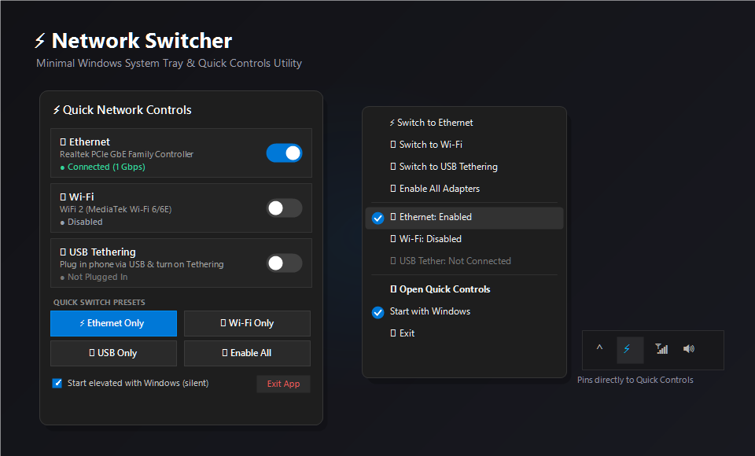

<div align="center">

# ⚡ Network Switcher

**Ultra-minimal, lightning-fast Windows utility to switch between Ethernet, Wi-Fi, and USB Tethering.**


-blue?style=for-the-badge)


<br/>



<br/>

*Sits quietly in your **System Tray / Hidden Icon Chevron (`^`)** or pins directly next to your Windows **Quick Controls** (Wi-Fi / Sound).*

</div>

---

## 🌟 Why Network Switcher?

Windows 11 and 10 do not provide a 1-click Quick Settings tile to enable/disable Ethernet or prioritize connections without navigating through multiple Settings pages or Control Panel menus.

**Network Switcher** solves this with a clean, single-purpose native Windows tray utility:
- **Zero bloat**: Single standalone **~48 KB executable**. No installers, no frameworks to install.
- **Microscopic memory usage**: Consumes **only ~2–5 MB of RAM** thanks to unmanaged working set trimming and direct registry inspection (zero heavy WMI COM overhead).
- **Zero CPU usage**: Pure **event-driven kernel hooks** (`NetworkChange.NetworkAddressChanged`). Sleeps 100% of the time while idle.
- **Fluent Dark UI**: Native Windows 11 rounded corners, acrylic dark aesthetic, and smooth toggle switches.

---

## ⚡ Key Features

### 🔀 1-Click Quick Switches
- **`[ ⚡ Ethernet Only ]`** — Activates Ethernet while disabling Wi-Fi and USB Tethering.
- **`[ 📶 Wi-Fi Only ]`** — Activates Wi-Fi while disabling Ethernet & USB Tethering.
- **`[ 📱 USB Only ]`** — Activates USB Tethering while disabling Ethernet & Wi-Fi.
- **`[ 🌐 Enable All ]`** — Re-enables all hardware network adapters simultaneously.

### 🔌 Independent Toggle Switches
- Real-time hardware adapter status: `● Connected (Speed)`, `● Cable Unplugged`, or `● Disabled`.
- Individual custom toggle switches for Ethernet, Wi-Fi, and USB Tethering.

### 📱 Automatic USB Tethering Detection
- Plug in an Android phone (via USB Tethering / Remote NDIS) or iPhone (via Apple Mobile Device Ethernet) and it is detected instantly without restarting the app.

### 🖱️ Dual-Mode Controls
- **Left-Click (Default)**: Opens the modern Fluent Quick Controls Flyout right above the taskbar. Clicking the icon again or clicking outside smoothly closes it.
- **Instant Ethernet Toggle Mode**: Optional 1-click mode where left-clicking the tray icon immediately toggles Ethernet ON / OFF with a brief notification.
- **Right-Click Menu**: Instant context menu styled in Windows 11 dark mode for direct presets and adapter toggles.

### 🚀 Silent Elevated Startup (No UAC Prompts on Boot)
- Disabling and enabling network hardware on Windows requires Administrator privileges.
- Checking **"Start elevated with Windows"** registers a Windows Scheduled Task with `HighestAvailable` run level. Network Switcher will launch automatically on user login **without ever showing a UAC prompt!**

---

## 📊 Performance Benchmarks

| Metric | Traditional Network Tools | **Network Switcher** |
|:---|:---:|:---:|
| **RAM Footprint** | 60 MB – 150 MB (Electron / WMI) | **~2 MB – 5 MB** |
| **Idle CPU Usage** | 0.5% – 2.0% (Polling loops) | **0.00%** (Kernel event-driven) |
| **Binary Size** | 50 MB – 120 MB | **48 KB** (Single .exe) |
| **Dependencies** | .NET 8 / Node / Python | **None** (Built into Windows) |

---

## 🚀 Quick Start Guide

### 1. Download & Launch
1. Download **[`NetworkSwitcher.exe`](NetworkSwitcher.exe)** from this repository (or from [Releases](../../releases)).
2. Double-click `NetworkSwitcher.exe` and accept the initial Windows UAC prompt (required to toggle network hardware).

### 2. Pin to Quick Controls (Next to Wi-Fi & Volume)
1. Click the **`^`** (hidden icons arrow) in your Windows taskbar.
2. Click and **drag the Network Switcher icon** out of the chevron onto your visible taskbar right next to your Wi-Fi and Volume icons.
3. Now it sits permanently right alongside your Quick Controls!

---

## 🛠️ Building from Source

Network Switcher is built in pure C# using standard .NET Framework 4.8 libraries pre-installed on every Windows 10 & 11 PC. No external SDKs, NuGet packages, or visual studio installations are needed.

To build the executable yourself:
1. Open PowerShell or Command Prompt in the `src/` directory.
2. Run `build.bat` or run:
```powershell
& "C:\Windows\Microsoft.NET\Framework64\v4.0.30319\csc.exe" /target:winexe /optimize+ /win32manifest:app.manifest /win32icon:app.ico /r:System.Windows.Forms.dll,System.Drawing.dll /out:..\NetworkSwitcher.exe Config.cs StartupManager.cs MemoryHelper.cs NetworkManager.cs IconGenerator.cs ToggleSwitch.cs QuickControlsFlyout.cs TrayApplicationContext.cs Program.cs
```

---

## 📂 Project Architecture

```
Network-Switcher/
│
├── NetworkSwitcher.exe         # Ready-to-use compiled standalone binary (48 KB)
├── README.md                   # Documentation & showcase
├── .gitignore                  # Git ignore rules
│
├── screenshots/
│   └── preview.png             # UI preview showcase
│
└── src/                        # Complete source code
    ├── Program.cs              # Entry point, elevation handler, single-instance mutex
    ├── TrayApplicationContext.cs # System tray icon, tooltip, context menu, event hooks
    ├── QuickControlsFlyout.cs  # Fluent dark-mode flyout UI & card layout
    ├── NetworkManager.cs       # Fast Registry-based adapter enumeration & netsh engine
    ├── ToggleSwitch.cs         # Custom smooth pill toggle switch control
    ├── IconGenerator.cs        # Vector tray icon renderer with real-time status dots
    ├── MemoryHelper.cs         # Native working set trimmer (EmptyWorkingSet)
    ├── StartupManager.cs       # Windows Scheduled Task integration for silent boot
    ├── Config.cs               # Settings manager (%APPDATA%\NetworkSwitcher)
    ├── app.manifest            # UAC execution level & Per-Monitor V2 DPI awareness
    ├── app.ico                 # High-resolution embedded application icon
    ├── build.bat               # 1-click compiler script
    ├── Install-Startup.bat     # Helper script to enable silent startup
    └── Uninstall-Startup.bat   # Helper script to disable startup
```

---

## 📜 License

This project is licensed under the **MIT License** — you are free to use, modify, and distribute it as you wish.
